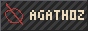
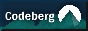

 <div align="center">


<details>
  <summary> <h1> ><b>⚡  ⚡</b> </h1></summary>
 
 
 
</details> 


 


Click  here !
<p>
 
[](https://app.hackthebox.com/users/834128)
 
<a href="https://belami.neocities.org/">
  
</a>

## ⚡ Skills & Tools ⚡


###


###


<br>


---


<br>

<div style="display: flex; gap: 7px; align-items: center; flex-wrap: wrap; justify-content: center;">
  <a href="https://codeberg.org/agathoz" target="_blank" rel="noopener noreferrer">
    
  </a>

  <a href="https://tangled.org/agathoz.tngl.sh" target="_blank" rel="noopener noreferrer">
    
  </a>

  <a href="https://gitlab.com/agathoz" target="_blank" rel="noopener noreferrer">
    
  </a>

  <a href="https://npmx.dev" target="_blank" rel="noopener noreferrer">

  </a>

  

<a href="https://nogithub.codeberg.page">
  
</a>
</div>
<br>

<br>
</div>

```text
 ______________________
1. No system is safe
2. Aim for the impossible
3. Have fun in cyberspace and meatspace
 ----------------------
        \   ^__^
         \  (oo)\_______
            (__)\       )\/\
                ||----w |
                ||     ||
```

<sub>Made with :heart: and coffee  :3< </sub>
